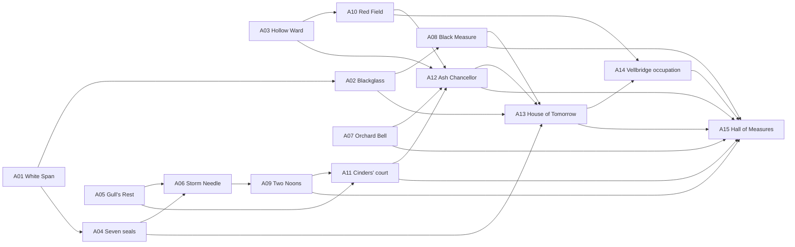

# Evidence and handouts

[Campaign home](README.md) · [Campaign ledger](10-campaign-ledger.md)

## How to give clues

Put the actual information into the players’ hands when they examine its source. Say what it supports and what remains an inference. Let Perception reveal a hidden compartment or an approaching guard; do not ask for Perception to decide whether a plainly visible order has a signature. A failed social roll may change a witness’s price, escort request, or trust, but another documented source remains available.

Evidence has a **holder**, an **original or copy status**, and a **provenance**. Brindle authenticates delivery and identity; he cannot certify that every claim inside a document is true. Two independent sources make a contested public case stronger than five copies of one forgery. A recognisable original plus willing testimony can secure a hearing without a successful roll to make obvious facts exist.

The revelations below are not a sequence. The company can learn how to stop the Concordance before learning who funded it, expose Sere before meeting the Chancellor, or defeat the dragon’s claim before ever seeing a command collar.

## Revelation map

| Revelation                                                              | Independent sources already placed in adventures                                                                                           | What players can do with it                                                                 |
| ----------------------------------------------------------------------- | ------------------------------------------------------------------------------------------------------------------------------------------ | ------------------------------------------------------------------------------------------- |
| R01 — The works have different underlying faults                        | A02’s reversed jack; A05’s consent and seated pearl; A07’s blight samples; A09’s boundary and dirty connectors                             | Stop searching for one universal curse; choose appropriate allies and repairs               |
| R02 — Rusk coordinates harmful interventions                            | A01’s replacement order; A02’s signed jack plate; A04’s dispatch revisions; A06’s payments                                                 | Follow him or his money to the Office; distinguish a clerk following orders from a director |
| R03 — Sere knowingly exploits and orders disasters                      | A08’s countersigned sabotage; A09’s suppressed diagnosis and payment; A13’s casualty list plus matching orders                             | Challenge her publicly, turn Nema, obtain a warrant, or remove her from leadership          |
| R04 — Local service can survive command isolation                       | A01’s margin note; A03’s surgeon’s instruction; A05’s dual panel; A07’s hymn; A13’s model                                                  | Preserve rescues while refusing imperial custody; make a new technical objective            |
| R05 — The Office intends permanent custodianship                        | A11’s appointment purchases; A13’s actual draft; A15’s public registry copy; A12’s client appointment papers expose the competing takeover | Warn claimants, change proposed terms, contest registry custody                             |
| R06 — Seven acknowledgements and a trained master are real requirements | A06’s cancellation note; A08’s tablet; A09’s operating records; A13’s complete folio                                                       | Disable one requirement rather than fight through every fortress                            |
| R07 — The date can be changed and the attempt aborted                   | A06’s test schedule; A09’s six-hour procedure; A13’s abort instructions; A14’s security timetable                                          | Plan entry and backup operations; stop treating Day84 as an inevitable prophecy             |
| R08 — The Hall has independent entrances and a service brake            | A08’s Ninefold atlas; A10’s withdrawal diagram; A11’s inspection contract; A12’s crypt plan; A15’s local maintenance plaques               | Enter without the chosen ruler’s permission; find an alternative to confronting the dais    |
| R09 — The Chancellor has observable weaknesses and escape limits        | A03’s medical inspector notes; A10’s old detention protocol; A12’s portraits, trial note, and roof plan                                    | Prepare for sunlight, Rose Lamp aversion, mist exits, and the actual destruction procedure  |
| R10 — The dragon’s debt and its added collateral are different claims   | A05’s old treaty; A09’s customs witness copy; A11’s original contract and memorial seals; A12’s forged schedule                            | Exclude Crownworks from collateral without pretending the original debt never existed       |
| R11 — Kest’s occupation needs an invitation, food, and troops           | A04’s copied requisition circular; A10’s pay records; A13’s contingency orders; A14’s inventory and invitation                             | Deny resources, negotiate withdrawal, or choose a limited military target                   |

R03 requires evidence of knowledge and action; a salary receipt alone is insufficient. R05’s appointment purchases suggest the mechanism, while the actual draft proves the intended duration. Investigations should sharpen conclusions rather than making the GM declare a person guilty because their name appeared once.

### Additional source placements for the reference clues

These small inserts belong in the existing administrative folders, not extra locked side rooms:

- **A03:** an inspector-treatment note records the Chancellor’s injury from a Rose Lamp presentation and inability to bear direct natural sunlight. Oren remembers treating victims and can describe the observed mist escape; he admits what he did not see.
- **A04:** the public annex contains Kest’s circular requesting “invitation, thirty days’ provisions, and gate access before deployment.” It is openly posted among relief requisitions.
- **A09:** the customs docket includes a copy of the authentic collateral list and the institutions that witnessed it. It does not include the later Crownwork addition.
- **A10:** an old detention protocol describes containing a vampire’s mist by sealing real exits, and the published adjacent full-round staking-and-decapitation procedure before Death Mist. It names the Rose Lamp as the Chancellor’s aversion. It is medical/security experience, not a claim that all undead have those traits.

## Adventure connections at a glance

Arrows indicate a useful clue, contact, or resource, not a locked prerequisite. Routes and travel costs come from the running chapter.

Every node also has independent local entrances in its text. For instance A07 does not need an incoming conspiracy clue: tenant and Court requests are enough. When giving a lead, name the destination, why it might help, likely travel cost, and any known deadline. “There may be something elsewhere” is not a useful actionable hook.

## When an expected clue is lost

Do not move the lost original into the next chest. Use another established source with its own limitations. A burned archive means slower reconstruction; a murdered witness means documents without living cross-examination; a sold map means obtaining its buyer’s cooperation. The consequences are real, and the campaign remains investigable.

If players draw a reasonable but incorrect conclusion, give them the world’s response. Maud demands to inspect the evidence; Dorr points out the loan’s dates; Oloa shows the seated pearl. NPC disagreement can reveal a testable distinction. Do not repeatedly tell the players they “feel something is wrong” until they guess the intended answer.

## H1 — Notices at the Brazen Mule

Give at the beginning, with the campaign date filled in. These three notices share one board; players can take copies.

> **CENTRAL MEASURE**
>
> Duplicate records scheduled for disposal on the sixth day of this month, at midnight. Inspection objections must be lodged before destruction. Chief Measurer Orsic’s office receives written enquiries.
>
> **BLACKGLASS QUARRY**
>
> Sale of outstanding lease and underground rights: eighth day, noon. Workers and lawful claimants may inspect the recorded terms through the appointed auditor, Pell Dorr.
>
> **GULL’S REST HARBOUR**
>
> Dangerous spring tide expected on the tenth day, possibly one day earlier or later. Boats, carpenters, and reliable hands needed. Report to the rescue house. River ferry departures continue each morning while the White Span is closed.

## H2 — Rusk’s restoration instruction

Place in A02’s office; an abbreviated copy may appear among A01’s notes.

> Office of Continuance — Works Account 7/31
>
> Install the replacement tension assembly according to the supplemental orientation, notwithstanding the original cast arrow. Record any subsequent displacement as settlement under load. Forward the removed plate and measurements to the House of Tomorrow, Crownseat.
>
> The receiving engineer is not authorised to publish a causation finding before central review.
>
> Cale Rusk, Survey Liaison

The original diagram nearby points in the opposite direction. The text and physical comparison together establish the deliberate interference.

## H3 — Pella’s comparison of dispatches

> I received these already sealed. All three came from the same annex, before any relay courier touched them.
>
> First copy: “Lower gate unsafe. Divert travellers. Request independent inspection.”
>
> Second copy: “Lower gate unsafe. Divert travellers. Admit Office inspectors.”
>
> Third copy: “Lower gate unsafe. Suspend local inspection. Admit Office custodians.”
>
> A valid seal tells me whose packet I carried. It does not tell me who changed the sentence before sealing it.
>
> Pella Underleaf, Station Seven

## H4 — The orchard maintenance hymn

Found behind the petitions at A07; the complete version is also in A15’s chapel archive. The diagram is described plainly so interpretation does not depend on solving poetry.

> Keep the root and spare the ring;
> Let the branch its shelter bring.
> When the distant hand would bind,
> Loose the collar, leave the rind.
>
> Beneath the verse, an old drawing shows a living graft held by two separate fittings. The broad lower cradle is labelled LOCAL SHELTER. A thin removable collar above it is labelled IMPERIAL DIRECTION. An arrow shows the collar withdrawing sideways while the cradle remains seated.

A hymn can preserve engineering without proving a theory about the gods.

## H5 — An observatory deposition

Found in A09’s instrument cabinet; another partial quotation appears in the Hall’s plaques.

> We reported that the stations did not agree. The order was to proceed and enter the refusals as errors.
>
> I saw no failure of the local works before that instruction. Their keepers had refused the common permission, which was a different matter.
>
> I cannot testify to what took place within the Hall. I can testify that our refusal was delivered, received, and overwritten on the public copy.

This is evidence of the attempted override. It does not explain the emperor’s disappearance.

## H6 — Varkesh’s notice

Delivered publicly on Day35, or earlier to a company that approaches the court.

> To the governments claiming the former emperor’s rights:
>
> A debtor’s death does not transfer his property and extinguish his obligations in the same convenient instant.
>
> At sunset on the sixty-third day I shall take possession of the East Toll Fort and its receipts unless a recognised party attends my court with a proposal, an objection supported by witnesses, or payment sufficient for a standstill.
>
> Representatives attending under this notice have safe passage to speak and depart. Armed theft is not representation.
>
> Varkesh-of-Cinders
>
> Witnessed by Enna Silt, Keeper of Accounts

## H7 — The custodian draft

Found at A13 and openly present on the Hall’s lectern if that version is submitted.

> Until the complete cessation of emergencies affecting the public works, the Office of Continuance shall retain exclusive authority to recognise, register, replace, and instruct their operators.
>
> No change of crown, council, ministry, or charter shall itself terminate this duty.
>
> The undersigned acknowledge the necessity of continuity.
>
> Veyran: __________ Ordel: __________ Castaine: __________

The absence of an independent expiry condition matters. Let players propose amendments, refuse endorsement, or expose the document; there is no password hidden in the signatures.
