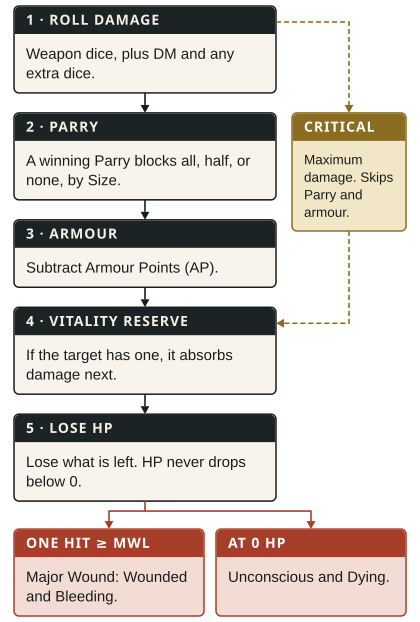

## Damage steps {#damage-steps}

When an attack hits:

1. **Roll damage:** weapon damage, plus Damage Modifier when it applies, plus any extra dice or fixed damage from the declared action or Talent.
2. **Parry:** if the defender won a Parry, reduce the damage by [Parry Size](/rules/combat/#attacks-and-reactions--parry-size).
3. **Armour:** subtract the target's Armour Points.
4. **Vitality reserve:** a [vitality reserve](/rules/magic/#effects--magic-vitality-reserves) absorbs damage next. Apply it after every other applicable reduction, just before actual HP.
5. **Lose HP:** reduce current HP by what is left. Neither damage nor current HP goes below 0.

> **Example.** An ogre's Heavy club hits you for 12 damage. Your arming sword is Medium, one Size smaller, so your winning Parry blocks half: 6 remain. Your leather armour (2 AP) stops 2 more. You lose 4 HP.

[Critical hits](/rules/combat/#critical-hits-and-fumbles) change these steps, as their matrix shows.

Damage Modifier applies to Close Combat, Unarmed Combat, and thrown attacks, not to bows, crossbows, or slings unless a Talent says otherwise.

## Major Wounds

When one hit deals damage at least equal to the target's Major Wound Level (`MWL`) after armour, apply the HP loss and both of these conditions:

- **Wounded:** `-1P` on every test.
- **Bleeding:** lose 1 HP at the end of every Combat Round.

Only damage that passes a vitality reserve and reaches actual HP counts toward a Major Wound.

These conditions do not stack. A further Major Wound still deals its damage and can restart Bleeding after it was removed, but creates no separate wound to track.

Do not make a Resilience test or roll on an injury table for a Major Wound.

## Dying

At 0 HP, you fall unconscious and are **Dying**. If you are still Dying at the end of the third Combat Round after reaching 0 HP, you die.

**Stabilising.** An adjacent helper spends a full round (Combat Action, Movement Action, and all Reactions) and succeeds at a Healing test, while both stay where they are. The test needs a Healing Kit or suitable improvised supplies, or is at `-2P`. Success removes Bleeding and Dying but restores no HP; a patient at 0 HP stays unconscious.

**After stabilising.** Successful Surgery or equivalent treatment restores 1 HP and lets natural recovery begin. Wounded ends after that treatment once current HP is greater than MWL. See [healing and recovery](/rules/adventuring/#healing-and-recovery).

## Hero Points

- **Prevent a Major Wound:** when a hit would cause one, spend 1 Hero Point. You still lose the full HP, but the hit causes no Wounded or Bleeding; it counts as ordinary damage, with no Major Wound for Surgery to treat.
- **Avoid Death:** at 0 HP, spend 1 Hero Point. You become stable and unconscious instead of Bleeding or Dying, and wake after the scene at 1 HP, still Wounded if you were already.

These are separate uses: if the damage you kept takes you to 0 HP, avoiding death costs another Hero Point.
