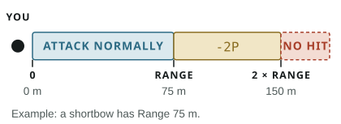

Make a Ranged Combat test against a target within your weapon's listed Range.

- **Up to Range:** attack normally.
- **Beyond Range, up to twice Range:** attack at `-2P`.
- **Farther than twice Range:** you cannot hit the target.

## Damage and close range {#damage-and-close-range}

- Thrown attacks add your Damage Modifier. Bows, crossbows, and slings deal only their listed damage, unless a Talent says otherwise.
- Within 2 metres, a ranged weapon with the **Close** tag attacks with Close Combat. Any other ranged weapon becomes an improvised Light club there: `1D6 + DM`, attacking at `-1P`.

## Defending against ranged attacks {#defending-against-ranged-attacks}

An aware target can Dodge at `-1P`, or meet thrown attacks and physical projectiles with [Active Guard](/rules/combat/#active-guard).

## Aim

Use your Combat Action to aim at one target you can see. Your next ranged attack against it gains `+1B`, unless you first take any Reaction, lose sight of the target, or fail to make that attack with your next Combat Action.

## Cover

Cover penalises the attack; it does not reduce damage.

| Cover                                       |         Modifier |
| ------------------------------------------- | ---------------: |
| Partial, such as a low wall                 |            `-1P` |
| Substantial, such as battlements            |            `-2P` |
| Complete: no attack line reaches the target | Attack prevented |

Terrain cover and the [Shield Cover](/rules/talents/#shield-cover) Talent do not add together; use only the better penalty.

## Common Situational Modifiers

[Illumination](/rules/adventuring/#light-and-darkness) has its own vision penalty, separate from the obscurity rows below.

| Situation                                                 |        Modifier |
| --------------------------------------------------------- | --------------: |
| Target moved at least 10 m since the attacker's last turn |           `-1P` |
| Target moved at least 30 m since the attacker's last turn |   `-2P` instead |
| Target partly obscured by mist, smoke, fog, or foliage    |           `-1P` |
| Target heavily obscured by mist, smoke, fog, or foliage   |   `-2P` instead |
| Target is prone                                           |           `-1P` |
| Target is helpless                                        |           `+2B` |
| High wind                                                 |           `-1P` |
| Fierce wind                                               |           `-3P` |
| Hurricane                                                 |    Attack fails |
| Attacker is prone                                         |           `-2P` |
| Attacker is on unstable ground                            |           `-1P` |
| Attacker is engaged at Close range                        | `-2P` per enemy |

Use only the strongest row for the same condition, such as movement, obscurity, or wind. Modifiers from different causes add together, up to the normal `+3B` or `-3P` limit.

## Crossbows

- **Light crossbow:** reloading uses your Movement Action and base Reaction.
- **Heavy crossbow:** reloading uses the whole round: Combat Action, Movement Action, and all Reactions.

A generic Ready action never shortens either reload.

## Firing Into a Crowd

Apply cover as normal. An ordinary failure simply misses. Only a fumble can hit someone else: a nearby target chosen fairly or at random, which takes normal rolled damage after armour.
