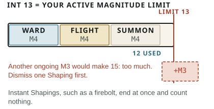

## Ongoing Shapings {#magic-ongoing}

Your **Active Magnitude** is the total Magnitude of all your ongoing Shapings. Active Magnitude cannot exceed permanent, unmodified INT.

INT represents the complexity a Shaper can keep organised, while POW supplies the PP that fuel and commit magic. A temporary change to INT does not affect this limit; a permanent change recalculates it.

**What counts.** Every ongoing Shaping counts its full Magnitude. This includes concentration, modifiers, Wards, barriers, summons, control, movement modes, senses, concealment, conditions, vitality reserves, waiting Triggers, and tied anchors. Enchantments moved into Enchantment Capacity are the only exception. A called being's own ongoing Shapings also count against its caller's total.

Instant effects and completed permanent transformations are no longer ongoing and count nothing. You can dismiss an ongoing Shaping on your turn without an Action.

### Keeping it going {#magic-maintenance}

- **Passive:** a passive ongoing benefit, including a subject-directed movement mode or fixed sense, needs Duration but no maintenance Action.
- **Summons:** a summon follows its [standing order](/rules/magic/#effects--magic-standing-orders) without maintenance; changing it costs the Shaper's Movement Action within 15 metres and line of effect.
- **Concentration and active control:** each costs your Combat Action every round. You can maintain only one at a time.

Check Range and route when a set Duration begins. After that, check them only during concentration or active control: the subject must stay within Range and a valid route, unless Range 4+, Indirect, or the Form creates another link. Damage or serious distraction to the Shaper forces a Persistence test; failure ends maintenance. Record each ongoing Shaping's Magnitude and casting result.

### Indefinite Shapings {#magic-indefinite}

An indefinite Shaping, or a permanent anchored enchantment made without Enchanter, commits full Magnitude from current and available maximum PP, even on a Critical.

- Your reduced maximum governs recovery while it lasts.
- Leave at least 1 available maximum PP, unless helplessness until an outside Dispel is a declared mythic price.
- When it ends, your maximum returns; current PP recover normally.
- Others cannot pay this commitment.

## Temporary matter {#magic-temporary-matter}

Temporary matter vanishes at Duration's end. It leaves no value, permanent crafting supply, PP, IP, Hero Points, Talents, components, anchors, or prices. Complex objects still require relevant Craft, Mechanisms, or Lore.

### Created hazards {#magic-created-hazards}

- Created matter or phenomena can provide paid terrain, obscurity, barriers, restraint, or other non-damaging effects, but never automatic Shaping damage each round.
- A harmful creation cannot appear overlapping an unwilling subject. Damage at its creation is one separately paid immediate Unmake outcome.
- Fire ignited in mundane fuel, a collapsing mundane structure, and other genuinely changed environmental hazards thereafter use the core rules rather than recurring magical damage.

## Universal magical actions {#magic-universal-actions}

These actions use your Practice and Tell but require no cell.

### Sense Magic {#magic-sense}

Spend a Combat Action and 1 PP, and test Shaping to sense active magic within 15 metres.

- **Success** reveals its location and Form.
- **Critical** also reveals its Technique, its Magnitude, and whether it is concentrated, triggered, or anchored.
- **Failure** reveals nothing.
- **Fumble** gives a false impression and a conspicuous Tell, not Backlash.

Veiled magic opposes your test with its original result.

### Dispel {#magic-dispel}

Spend a Combat Action to end one active Shaping.

1. **Price it.** Dispel Magnitude equals the target's full Magnitude plus Range. Reach is 0 for one Shaping, regardless of its area.
2. **Cast it.** Test Shaping and pay normally.
3. **Beat the original.** On a Success or Critical, oppose that result with the original Shaper's current unmodified Shaping. If that is unknown, use `10 × original Magnitude`, maximum 100%. The dispeller must succeed and win.

Completed permanent transformations cannot be Dispelled; active anchored enchantments can.
