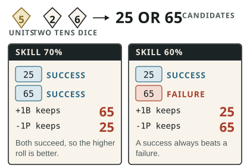

Bonus dice (`+1B`, `+2B`…) improve a test; Penalty dice (`-1P`, `-2P`…) hinder it.

1. Total all Bonus and Penalty dice, cancel them one for one, and cap what remains at `+3B` or `-3P`.
2. Roll one units die and one tens die, plus one extra tens die for each remaining Bonus or Penalty die.
3. Pair the shared units die with every tens die to form the candidate `D100` results. Read `00` as 100.
4. With Bonus dice, always keep the result that is better for the roller. With Penalty dice, always keep the result that is worse for the roller.

**Which result is better?** Grade every candidate first: **Critical > Success > Failure > Fumble**. Within Critical or Success, the higher roll is better. Within Failure or Fumble, the lower roll is better. Use this order even when the test is not opposed. If [Deadly Precision](/rules/talents/#deadly-precision) applies, grade every candidate with its doubled critical range.

Choose the result before comparing participants in an [opposed test](/rules/skills/#opposed-tests). Base skill and defender or status-quo tiebreakers never choose between one roller's candidates. Bonus and Penalty dice change the roll, not the skill or its critical range.

## When to apply them {#skills-apply-bonus-penalty}

Apply dice only for circumstances that materially change the task, such as terrain, tools, visibility, preparation, time pressure, injuries, or a sound or flawed approach.

A modest advantage or obstacle is usually `+1B` or `-1P`. Use larger modifiers only when several strong factors point the same way; the final net modifier never exceeds three dice.
