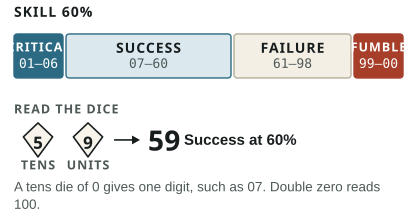

## Dice notation

`D4`, `D6`, `D8`, `D10`, and `D12` name a die by its number of sides. A number before the `D` is how many to roll and add: `2D6` means two six-sided dice. A flat modifier follows, as in `1D6+2`.

For `D100`, roll two ten-sided dice, one for tens and one for units. A tens die of `5` and a units die of `9` read 59. A zero on the tens die gives a single digit, such as `07`, and `00` reads as 100.

`+1B` means one Bonus die and `-1P` one Penalty die. They add tens dice to a D100 test; they never change the skill. Bonus dice always keep the better result; Penalty dice always keep the worse. See [Bonus and Penalty Dice](/rules/skills/#bonus-and-penalty-dice).

## Make a test

1. **State the approach and intended outcome.** The Gamemaster clarifies what success achieves and what failure risks.
2. **Set modifiers.** Add Bonus and Penalty dice for circumstances, cancel opposites, and cap the net at `+3B` or `-3P`.
3. **Roll D100.** A result at or below the skill succeeds. Read the dice as rolled; never add modifiers to the percentage.
4. **Resolve.** Apply the outcome agreed in step 1. When two characters compete directly, use an [opposed test](/rules/skills/#opposed-tests).

Do not roll for routine actions, impossible actions, or actions whose failure has no meaningful consequence. The Gamemaster simply states the outcome.

## Result grades

| Roll                                        | Grade    |
| ------------------------------------------- | -------- |
| From `01` through the skill's tens digit    | Critical |
| At or below the skill                       | Success  |
| Above the skill                             | Failure  |
| `99–00` below 100% skill; only `00` at 100% | Fumble   |

The critical ceiling is the integer tens digit, minimum `01` for any skill above 0%. A 5% skill is critical only on `01`, 59% on `01–05`, and 60% on `01–06`.

## Let the fiction lead

Rules settle uncertain moments; they do not replace physical sense. The Gamemaster can grant dice for a strong advantage, rule that scale or anatomy makes an action impossible, or let an obvious approach succeed without a test. State such rulings before the roll whenever possible.

## Measures and rounding

Distances are in metres, and durations use ordinary seconds, minutes, and hours. On a grid, the group can treat each square as 2 metres.

Round to the nearest whole number; round exact halves up. Damage never goes below 0 after all reductions.
